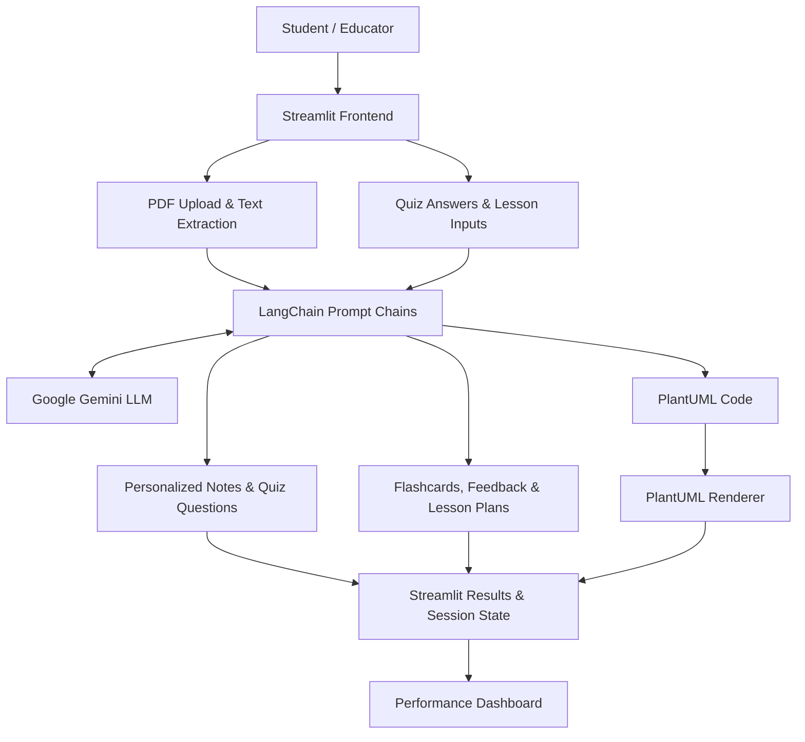

# AI Educational Assistant

An AI-powered learning and teaching assistant that transforms educational content into personalized study materials, interactive assessments, and visual explanations.
## The Problem
Students often struggle to convert lengthy academic materials into structured, engaging study resources. Traditional learning methods require manually preparing notes, creating practice questions, and identifying knowledge gaps.

At the same time, educators spend considerable time preparing lesson plans, assessments, and supplementary learning materials.
## Target Audience
- Students: Generate personalized notes, practice questions, flashcards, and feedback to support independent learning.
- Educators: Create structured lesson plans and supporting teaching materials.
- Self-directed learners: Explore educational content through different explanation styles and visual representations.
## Our Solution
AI Educational Assistant is a prototype built using Python, Streamlit, LangChain, and Google Gemini.

It brings together PDF-based content generation, interactive practice, AI-assisted feedback, visual learning, and lesson planning within a single application.

The goal is to simplify study preparation and make educational content more accessible and engaging.

## 🏗️ System Architecture

The AI Educational Assistant uses Streamlit for its user interface, LangChain for coordinating AI interactions, and Google Gemini for generating educational content.

### How It Works

1. **User Interaction:** Students upload learning materials, answer questions, or enter lesson-planning requirements through the Streamlit interface.
2. **Document Processing:** pdfplumber extracts text from uploaded PDF documents.
3. **AI Processing:** LangChain constructs prompts and communicates with Google Gemini.
4. **Content Generation:** Gemini generates personalized notes, questions, flashcards, answer feedback, and lesson plans.
5. **Visual Learning:** PlantUML converts AI-generated diagram definitions into visual diagrams.
6. **Performance Tracking:** Streamlit stores assessment results during the session, while Matplotlib visualizes student performance.

